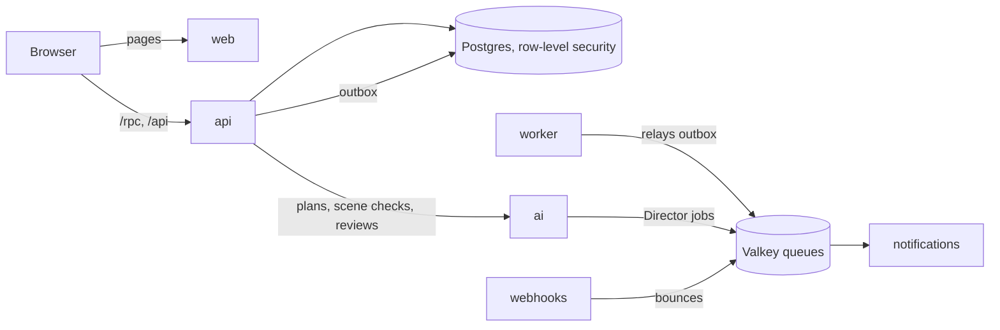

# Director-editor

Director: pick a YouTube Short you love, and it plans your own take shot by shot, guides
you through filming each one, reviews every take with Gemini and puts the short
together. Under it, a full-stack starter built to run in production: sign-up and sign-in
(passwords with emailed verification codes, passkeys, two-factor, Google), a personal
workspace per account, email, file uploads with virus scanning, a REST API, and the
infrastructure to ship all of it.

Everything is in the repo and off by default. The core profile starts in minutes on a
laptop; each optional feature switches on when its settings are present.

## Day 1: a demo or a hackathon

You need Node 24 (`nvm use`), Bun 1.3, Docker, and [uv](https://docs.astral.sh/uv/):
code generation runs the Python service's exporter, so setup, `bun dev`, types and tests
need it even if you never touch Python. `bun run doctor` checks all of it. Nothing to
install: with VS Code or Codespaces, the devcontainer (`.devcontainer/`) has Node, Bun,
uv, Docker and what shipping needs (OpenTofu, kubectl, Helm with helm-unittest, kind,
sops, age and gh), and runs setup when it's created.

```sh
bun run setup     # once: .env with fresh secrets, dependencies, local services, migrations
bun dev           # web :3000, api :3001, worker :3002, notifications :3003, webhooks :3004
bun run db:seed   # optional: a demo user
```

Open http://localhost:3000 and sign up. Verification codes and every other email land
in Mailpit at http://localhost:58025. `bun dev:full` adds the AI service (:8000) and its
worker, RustFS and ClamAV, the Stalwart mail server, Jaeger and the email previews
(:3030). Uploads switch on with `bun run env:set S3_BUCKET=uploads`
([docs/files.md](docs/files.md)); Director needs them, the AI service and a real Gemini
and YouTube key ([docs/director.md](docs/director.md)).

Local services run in Docker with memory limits on their own ports (55432 for
Postgres, 56379 for Valkey, 5xxxx for the rest), so they sit beside other projects. The
core needs about 1.4 GB of Docker's memory free, the full profile about 3.9 GB; the start
refuses when they don't fit. `bun run docker:clean` removes everything this repo created
in Docker.

When something is off, `bun run doctor` says what and how to fix it, and
[docs/troubleshooting.md](docs/troubleshooting.md) covers the rest. Then
[CONTRIBUTING.md](CONTRIBUTING.md) has the conventions and
[docs/README.md](docs/README.md) the rest of the docs.

## Going to production

[docs/new-project.md](docs/new-project.md) is the checklist from the first clone to the
first production release, in order: making it yours, the GitHub settings, secrets per
environment, machines and DNS, the first deploy and what only a real cluster shows, and
the first release. [docs/deploy.md](docs/deploy.md) explains how changes then flow to
staging and production.

## What's inside

| Path | What |
|---|---|
| `apps/web` | Next.js, render-only: every read and write goes through the API |
| `apps/api` | NestJS on Fastify: auth (better-auth), the oRPC API for the web app, REST at `/api/v1` with an OpenAPI document, Director's live call relay |
| `apps/worker` | Outbox relay, audit log, file scanning, scheduled jobs |
| `apps/notifications` | Email: sign-in codes and security alerts |
| `apps/webhooks` | Inbound provider webhooks (the mail server's bounces) |
| `apps/ai` | Python: FastAPI and Pydantic AI on Gemini, Director's plans and take reviews |
| `packages/*` | Contracts, the API client and hooks, database, jobs, i18n, email templates, UI kit, shared Nest plumbing |
| `deploy/` | Container images, Helm charts, Argo CD, the local kind cluster |
| `infra/tofu` | OpenTofu: k3s on machines you run anywhere, Cloudflare in front, the Argo CD bootstrap |



Every tenant row is guarded by forced row-level security and each service connects as
its own least-privileged database role. Writes that other services react to go through
a transactional outbox, so nothing is lost between a commit and a queue.
[docs/architecture.md](docs/architecture.md) has the whole picture.

## Everyday commands

| Task | Command |
|---|---|
| Lint, formatting, boundaries, unused code | `bun run lint` (`bun run format` fixes) |
| Types | `bun run check-types` |
| Unit tests | `bun run test` |
| Integration tests (real Postgres, Valkey, Mailpit) | `bun run test:integration` |
| End-to-end (web, and the API's fuzzing); stop `bun dev` first, it refuses busy ports | `bun run test:e2e` |
| Regenerate code after a schema or contract change | `bun run gen` |
| New migration | `bun run db:migrate` |
| Set a secret in `.env` | `bun run env:set KEY=value` |

[docs/testing.md](docs/testing.md) covers every test layer and what CI runs.

## Scaling path

Anything that changes as you grow sits behind one interface that every caller already
uses. Growing means writing a second implementation, not touching the callers. Each row
has a `swap-*` skill in `.claude/skills`.

| Concern | Now | Later | Where the interface is | Skill |
|---|---|---|---|---|
| Event transport | BullMQ on Valkey | Kafka, Redpanda, NATS JetStream | `apps/worker/src/outbox/event-bus.ts` | `swap-event-transport` |
| Outbox reading | polling with `SKIP LOCKED` and `LISTEN` | change data capture (logical replication) | `apps/worker/src/outbox/relay.service.ts` | `swap-outbox-source` |
| Read replicas | reads go to the primary | a replica behind `database.read` | `packages/db/src/client.ts` | `swap-read-replicas` |
| Object storage | S3 API on RustFS, locally and in the cluster | any S3-compatible provider (S3, R2, …), or one without an S3 API | `packages/nest-common/src/storage.ts` | `swap-storage` |
| File scanning | ClamAV | a scanning service | `apps/worker/src/files/file-scanner.ts` | `swap-file-scanner` |
| Email | SMTP to our Stalwart mail server (Mailpit locally) | any SMTP server, or a provider API | `apps/notifications/src/channels/email/email-transport.ts` | `swap-email-provider` |
| Notification templates | in code | a database, edited without a deploy | `apps/notifications/src/dispatch/templates.ts` | `swap-notification-templates` |
| Translations | JSON bundled in `packages/i18n` | a database plus Redis cache | `packages/nest-common/src/i18n.ts` | `swap-translations` |
| Realtime fan-out | pub/sub on the shared Valkey | a dedicated Redis or NATS | `packages/nest-common/src/realtime.ts` | `swap-realtime` |
| DNS and certificates' DNS-01 | Cloudflare, with its proxy in front | a name server of our own (RFC 2136, built in), or another provider | `dns` in `infra/tofu/envs/k3s`, and the cluster's `dns-*` annotations the platform add-ons read | `swap-dns` |

Some growth steps don't need an interface, because they're configuration or a move:
Valkey moves to a bigger instance of its own through `REDIS_URL`; auth (better-auth in
`apps/api/src/auth`) can move to its own service or an external identity provider, since
clients only talk to `/api/auth` on the site's origin; a very large tenant can get its
own database, as every query already runs inside a tenant context; traces and metrics go
to any OpenTelemetry collector once `OTEL_EXPORTER_OTLP_ENDPOINT` is set
(`packages/nest-common/src/telemetry.ts`, `apps/ai/app/telemetry.py`). Search across
a workspace's data isn't built in; [enhancements.md](docs/enhancements.md#search) says
where to start.

## Shipping

Every merge to `master` builds signed, attested images for amd64 and arm64 and deploys
them to staging. A version tag you push (`git tag v1.4.0`) publishes a release with
notes from the commits, and `bun run promote v1.4.0` opens the pull request that points
production at it. Pull requests labelled `preview` get an environment of their own.
See [docs/deploy.md](docs/deploy.md), [deploy/README.md](deploy/README.md),
[infra/tofu/README.md](infra/tofu/README.md) and, for the one-time GitHub setup,
[docs/repository-settings.md](docs/repository-settings.md).

## Working with Claude Code

The repo is set up for Claude Code: `CLAUDE.md` and path-scoped rules, skills for every
lifecycle task (setup, dev, add a feature, change the database, deploy, release, roll
back, swap a seam), review agents, and hooks that format on edit, guard generated files
and secrets, and run the affected tests before a turn ends. The skills in
`.claude/skills/` are plain step-by-step runbooks, readable without Claude too
([docs/README.md](docs/README.md#runbooks) lists them).

## Contributing and license

See [CONTRIBUTING.md](CONTRIBUTING.md) and [SECURITY.md](SECURITY.md). The code is
published for viewing only; all rights reserved (see [LICENSE](LICENSE)).
