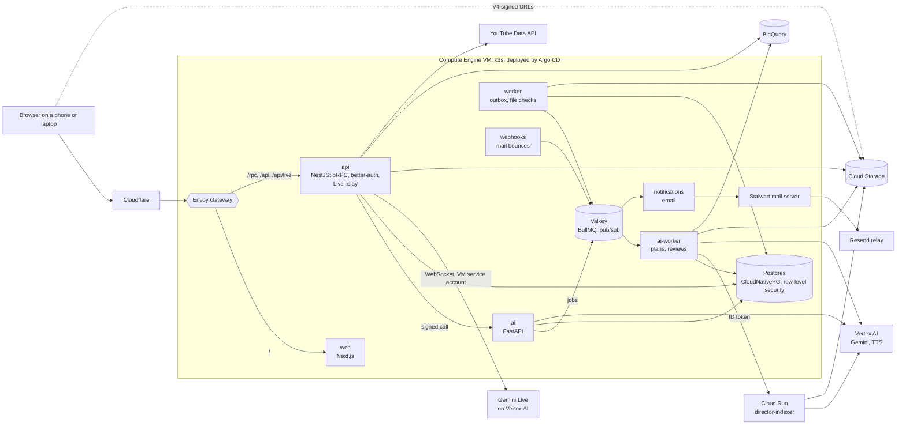

# Director

Director turns any YouTube Short into a template a first-time creator can follow, shot by
shot, and then directs them through filming their own version over a live video call with
Gemini. Gemini on Vertex AI watches the original and writes the plan: every cut, what each
moment is for, where to stand, how to hold the phone and what to say. On the shoot, Gemini
Live sees through the phone's camera, talks the creator into place and presses record for
them. Gemini then scores every take, picks the best one of each shot and flags the shots
worth filming again, and the creator assembles the video on a timeline built for
beginners and publishes it to their own YouTube channel. It all runs on Google Cloud.

## Try it

Open **https://director.mmadan.in**. The landing page shows what Gemini made of a real
Short, and "Try the demo" opens the sign-in page with a shared demo account already filled
in. The account's email and password are printed on the sign-in page itself (its "Use
demo account" button fills the form), so they aren't repeated here.

The demo account starts with the 6 starter templates and can index one Short of its own,
shared by everyone who uses it. It can't publish to YouTube or change its own account; sign
in with Google, or sign up, to publish to your own channel. A phone gives the fullest
experience: the camera screen also uses its tilt sensor for the angle guide. Allow the
camera and the microphone when the browser asks.

<!-- screenshots added after deploy -->
| Landing | Library | Template | Call |
|---|---|---|---|
|  |  |  |  |
| **Editor** | **My media** | **Publish** | |
|  |  |  | |

## What a creator does

1. **Pick a template** (`/library`). Every account starts with 6 Shorts Gemini has already
   indexed (a talking head, a product unboxing, a recipe, travel transitions, a text-led
   Short and a dance), and one slot to paste a YouTube Short of their own. Indexing runs
   in the background on a private Cloud Run service <!-- verify after deploy: INDEXER_URL
   set -->, and the card shows each real stage
   as it's reached: waiting for Gemini, Gemini watching the Short, writing the shot list,
   ready (or failed, with the reason). A second Short of your own opens a "You've used your
   AI credit" dialog: each account indexes one.
2. **See what Gemini understood** (`/director/<videoId>`). The original plays beside its
   storyboard: each shot's purpose in the story, where to be, the framing, the phone's
   angle and height, the pose, the steps and the lines to say, and, for a Short with
   speech, a choice between recording your own voice and filming to the original's sound.
3. **Shoot on a call with Director.** "Call Director" starts a voice-and-video call with
   Gemini Live. It sees a frame a second from the camera, hears you, speaks its
   directions in a natural voice, and you can talk back or interrupt. It acts for you:
   it starts and stops recording, throws a take away for another go, and moves to the
   next shot. Live captions show both sides. Director Live's guides stay on screen under
   the call: a teleprompter, a stick figure to copy the pose from, footprints for where
   to stand, a horizon for the phone's tilt. Without a call, or when one can't start,
   Director Live guides the shot on its own, with Gemini's scene checks of the camera
   and spoken cues in a Gemini text-to-speech voice.
4. **Takes and reviews.** Every take of every shot is kept. Gemini reviews each one as
   it arrives: the stretch worth keeping, a score out of 100, and one thing to try next.
   The best-scored take of each shot is picked, and a shot whose best take scored below
   60 asks for a retake. You can retake any shot whenever you like.
5. **Edit** (`/director/<videoId>/edit`). The video's shots run left to right, each shot's
   takes stack beneath it with Gemini's pick highlighted, and a stepper per shot chooses
   another take. Captions come in two styles or none. "Save video" renders the cut in
   the browser and saves it.
6. **My media** (`/media`). Saved videos, grouped by the template each was made from;
   one template can have many.
7. **Publish to YouTube Shorts.** <!-- verify after publish merges --> From My media,
   Gemini drafts the title, description, hashtags and credits (the original creator and
   a link to the original Short); you review and edit every field and choose the
   visibility (unlisted by default), and only your tap uploads it to your own channel.
   Director asks for YouTube upload permission the first time you publish, not at
   sign-in.

[docs/how-it-works.md](docs/how-it-works.md) explains each step underneath.

## Built on Google Cloud

| Service | What it does in Director | Where in the code |
|---|---|---|
| Vertex AI: Gemini 4 Argon (`gemini-4-argon`) | Watches a Short from its YouTube URL and writes the shot plan | `apps/ai/app/indexing.py` (`index_short`), `apps/ai/app/director.py` (the prompt, `create_local_indexer`) |
| Vertex AI: Gemini 3.1 Pro (`gemini-3.1-pro-preview`) | The indexing fallback, once Gemini 4 Argon's retries are spent | `apps/ai/app/indexing.py`, `INDEX_FALLBACK_MODEL` in `apps/ai/app/settings.py` |
| Vertex AI: Gemini 3.8 Flash (`gemini-3.8-flash`) | Scene checks from a camera frame, and take reviews (best part, score, feedback); Director's YouTube post <!-- verify after publish merges --> | `apps/ai/app/director.py` (`check_scene`, `review`) |
| Vertex AI: Gemini Live (`gemini-live-2.5-flash-native-audio`) | The voice-to-voice video call that directs each shot and drives the recorder through tool calls | `apps/api/src/modules/live/` (the relay), `apps/web/src/modules/director/lib/call-session.ts` (the browser's side) |
| Vertex AI: Gemini 3.8 Flash TTS (`gemini-3.8-flash-tts`) | Director's spoken cues on the shoot screen when no call is running | `apps/ai/app/speech.py`, `apps/api/src/modules/director/director.service.ts` (`speak`, which keeps each line in storage) |
| Vertex AI: Veo 3.1 Lite (`veo-3.1-lite-generate-001`) | A few seconds' "how this shot looks" preview clip for each shot of the 6 starter templates | `apps/ai/scripts/seed_media.py`; linked by `apps/api/src/modules/director/seed-media.ts` |
| Vertex AI: Nano Banana 2.1 (`gemini-nano-banana-2.1`) | A storyboard card for each shot of the starter templates | the same |
| Vertex AI: Lyria 3 Clip (`lyria-3-clip-preview`) | A royalty-free soundtrack for each starter template, matched to its mood and pace | the same |
| Cloud Run | `director-indexer`, a private service that indexes one Short per request, off the VM | `apps/ai/app/indexer.py` (the service), `RemoteIndexer` in `apps/ai/app/indexing.py` (the caller) |
| Cloud Storage | Takes, saved videos, spoken lines, the original's captured audio and the starter media; browsers read and write them through V4 signed URLs | `packages/nest-common/src/storage.ts` (`GcsStorage`), `apps/ai/app/audio.py` (the original's audio, captured with yt-dlp) |
| BigQuery | Product events (`indexed`, `take_reviewed`, `call_started`), streamed into one table (`director.events` in production) | `packages/nest-common/src/analytics.ts`, `apps/api/src/modules/analytics/`, `apps/ai/app/analytics.py` |
| YouTube Data API v3 | Checks a pasted link is a public video of 3 minutes at most before indexing; uploads a finished video <!-- verify after publish merges --> | `apps/api/src/modules/shorts/youtube.ts`; the upload in `apps/api/src/modules/publish/youtube-upload.ts` <!-- verify after publish merges --> |
| Google sign-in (OAuth) | Sign-in with a Google account, and the `youtube.upload` permission asked for on the first publish <!-- verify after publish merges --> | `apps/api/src/auth/auth.ts` (`socialProviders`) |
| IAM | `signBlob` signs Cloud Storage URLs for the VM's service account (no key file); Google-signed ID tokens let only the VM's account call the Cloud Run indexer | `packages/nest-common/src/storage.ts`; `apps/ai/app/google_auth.py` (`id_token`, `verify_invoker`) |
| Compute Engine | One VM runs the whole cluster (k3s); its metadata server hands the services their Google credentials | `apps/api/src/modules/live/google-auth.ts` (`metadataServerAuth`), `allowMetadataServer` in `deploy/environments/production/stack.yaml` |
| Artifact Registry | Holds the image Cloud Run runs the indexer from | [docs/deploy.md](docs/deploy.md#the-cloud-run-indexer) |

Veo, Nano Banana and Lyria run once, from a developer's machine, to make the starter
templates' media (`bun run --filter @repo/ai seeds:media`); the running app serves what
they made. No service has a key file: the VM and the Cloud Run indexer use their own
service accounts, and the AI service reaches Gemini with a Vertex AI express-mode key.

## Architecture



The web app only renders: every read and write goes through the API, which signs each
call it makes to the AI service. Long work goes on BullMQ queues in Valkey; the AI worker
sends each Short to the Cloud Run indexer with an ID token, saves the plan, and nudges the
browser over a realtime channel as each stage is reached. Takes and finished videos go
straight between the browser and Cloud Storage through signed URLs. Every workspace's
rows are guarded by forced row-level security, and each service connects as its own
least-privileged database role. Production is one Compute Engine VM running k3s, which
Argo CD keeps in step with this repository; its images are signed in CI and Kyverno
admits only signed ones. [docs/architecture.md](docs/architecture.md) has the whole
picture and [docs/deploy.md](docs/deploy.md) how it ships.

## How indexing works

The AI worker reserves tokens from the workspace's monthly allowance and hands the Short
to the indexer (on Cloud Run in production). <!-- verify after deploy: INDEXER_URL set -->
Gemini 4 Argon watches the YouTube URL itself, at 3 frames a second, with a prompt written
for the Shorts that break naive plans: no person in shot, no speech, on-screen text and
doodles, fast cuts, slideshows, and Shorts with more cuts than the 12-shot cap. It answers
in a schema that is the plan the camera screen reads (shots, timings, purpose, scene,
framing box, phone angle, pose, steps with camera moves, the script word for word). A
transient failure is retried twice, then Gemini 3.1 Pro tries once. A deterministic repair
step then makes the timings consistent (shots in order, never overlapping, inside the
video, script lines inside their shot, durations that fit) instead of failing a whole plan
over one bad number. The original's audio is captured with yt-dlp into Cloud Storage. Each
stage is stored and announced: queued, watching, writing, ready or failed with a reason.
An evaluation set of 12 real Shorts (the 6 starters and 6 hard cases) checks that every
one indexes into a shootable plan: `bun run --filter @repo/ai evals:index`.
[How it works: indexing](docs/how-it-works.md#indexing-a-short) has the details.

## How the live call works

The browser opens a WebSocket to the API's `/api/live` with its session cookie. The API
checks the caller and the plan, then opens Gemini Live on Vertex AI as the VM's service
account and relays both ways. Up go 16 kHz 16-bit mono PCM from the microphone, in
100 ms chunks, and a 640-pixel JPEG of the camera about once a second; down come Gemini's
24 kHz voice, both sides' transcripts, and its tool calls. Gemini has five tools,
`start_recording`, `stop_recording`, `retake`, `next_shot` and `previous_shot`, which the
browser carries out exactly as it would the creator's own spoken request. One call lasts
the whole Short: moving to another shot sends Gemini that shot's brief in the same
conversation. Calls last up to 10 minutes, and when one can't start or drops, the shot
carries on with Director Live's on-device guides and its takes untouched.
[How it works: the live call](docs/how-it-works.md#the-live-call) has the details.

## Run it locally

You need Node 24, Bun 1.3, Docker and [uv](https://docs.astral.sh/uv/) (`bun run doctor`
checks them), or the devcontainer in `.devcontainer/`, which has them all.

```sh
bun run setup     # once: .env with fresh secrets, dependencies, local services, migrations
bun dev:full      # every service: web :3000, api :3001, the AI service :8000 and its worker
```

Director calls the real Google services, locally too, so it stays off until you give it
a YouTube Data API key, a Vertex AI key and project, and turn uploads on:
[docs/director.md](docs/director.md#turning-it-on) has the commands, and
[CONTRIBUTING.md](CONTRIBUTING.md) the everyday commands and conventions. The tests never
need a key: they start a local stand-in for Google's APIs themselves.

## Repository map

| Path | What |
|---|---|
| `apps/web` | Next.js, render-only: the library, template, camera, editor and My media (`src/modules/director`), the landing page (`src/modules/marketing`) |
| `apps/api` | NestJS on Fastify: auth (better-auth), the oRPC API, the YouTube link check, the Gemini Live relay (`src/modules/live`) |
| `apps/ai` | Python, FastAPI and Pydantic AI on Gemini: indexing, scene checks, take reviews, speech, and the BullMQ worker; `app/indexer.py` is the Cloud Run indexer, `evals/` the indexing evaluation, `scripts/` the starter templates' builders |
| `apps/worker` | Outbox relay, audit log, upload checks (type and ClamAV), scheduled jobs |
| `apps/notifications` | Email: sign-in codes and security alerts |
| `apps/webhooks` | Inbound webhooks (the mail server's bounces) |
| `packages/contracts` | The API contract, limits and error codes, the live call's messages, the 6 starter templates (`src/director-seeds.json`) |
| `packages/*` | Also the API client and hooks, database (Prisma, migrations, row-level security), queues, i18n, email templates, UI kit with the Gemini loaders, shared Nest plumbing |
| `deploy/` | Container images, Helm charts, Argo CD, the cluster's add-ons (Kyverno, cert-manager, the mail server) |
| `infra/tofu` | OpenTofu: k3s on the machines, Cloudflare in front, the Argo CD bootstrap |
| `docs/` | Everything else, indexed in [docs/README.md](docs/README.md) |

## The engineering underneath

Director is built on a full-stack starter run to production standards: every service
validates its input at the boundary, every user-facing string is translated, unit and
integration tests cover every line and branch, end-to-end tests drive the real app in
Chromium, and CI scans images and dependencies before anything ships. The details:

- [docs/architecture.md](docs/architecture.md): the services, how a request flows, tenancy
- [docs/testing.md](docs/testing.md): every test layer and what CI runs
- [docs/deploy.md](docs/deploy.md): images, environments, releases and the Cloud Run indexer
- [docs/environment.md](docs/environment.md): every setting, including each Google one
- [docs/new-project.md](docs/new-project.md): starting another app from this repository

### Scaling path

Anything that changes as Director grows sits behind one interface that every caller
already uses. Growing means writing a second implementation, not touching the callers.
Each row has a `swap-*` skill in `.claude/skills`.

| Concern | Now | Later | Where the interface is | Skill |
|---|---|---|---|---|
| Event transport | BullMQ on Valkey | Kafka, Redpanda, NATS JetStream | `apps/worker/src/outbox/event-bus.ts` | `swap-event-transport` |
| Outbox reading | polling with `SKIP LOCKED` and `LISTEN` | change data capture (logical replication) | `apps/worker/src/outbox/relay.service.ts` | `swap-outbox-source` |
| Read replicas | reads go to the primary | a replica behind `database.read` | `packages/db/src/client.ts` | `swap-read-replicas` |
| Object storage | S3 API on RustFS, locally and in kind; Google Cloud Storage in production (`STORAGE_PROVIDER=gcs`, Application Default Credentials) | any other S3-compatible provider (S3, R2, …), or one without an S3 API | `packages/nest-common/src/storage.ts` | `swap-storage` |
| File scanning | ClamAV | a scanning service | `apps/worker/src/files/file-scanner.ts` | `swap-file-scanner` |
| Email | SMTP to our Stalwart mail server (Mailpit locally) | any SMTP server, or a provider API | `apps/notifications/src/channels/email/email-transport.ts` | `swap-email-provider` |
| Notification templates | in code | a database, edited without a deploy | `apps/notifications/src/dispatch/templates.ts` | `swap-notification-templates` |
| Translations | JSON bundled in `packages/i18n` | a database plus Redis cache | `packages/nest-common/src/i18n.ts` | `swap-translations` |
| Realtime fan-out | pub/sub on the shared Valkey | a dedicated Redis or NATS | `packages/nest-common/src/realtime.ts` | `swap-realtime` |
| Product analytics | BigQuery, streamed one event at a time | a managed pipeline (Segment, PostHog) or a different warehouse | `packages/nest-common/src/analytics.ts`, `apps/ai/app/analytics.py` | `swap-analytics` |
| DNS and certificates' DNS-01 | Cloudflare, with its proxy in front | a name server of our own (RFC 2136, built in), or another provider | `dns` in `infra/tofu/envs/k3s`, and the cluster's `dns-*` annotations the platform add-ons read | `swap-dns` |

Where indexing runs is a seam too: `Indexer` in `apps/ai/app/indexing.py`, today the
Cloud Run indexer or the worker itself. Some growth steps need no interface, because
they're configuration or a move: Valkey moves to a bigger instance of its own through
`REDIS_URL`; auth (better-auth in `apps/api/src/auth`) can move to its own service or an
external identity provider, since clients only talk to `/api/auth` on the site's origin;
a very large tenant can get its own database, as every query already runs inside a
tenant context; traces and metrics go to any OpenTelemetry collector once
`OTEL_EXPORTER_OTLP_ENDPOINT` is set (`packages/nest-common/src/telemetry.ts`,
`apps/ai/app/telemetry.py`).

## Contributing and license

See [CONTRIBUTING.md](CONTRIBUTING.md) and [SECURITY.md](SECURITY.md). The code is
published for viewing only; all rights reserved (see [LICENSE](LICENSE)).
